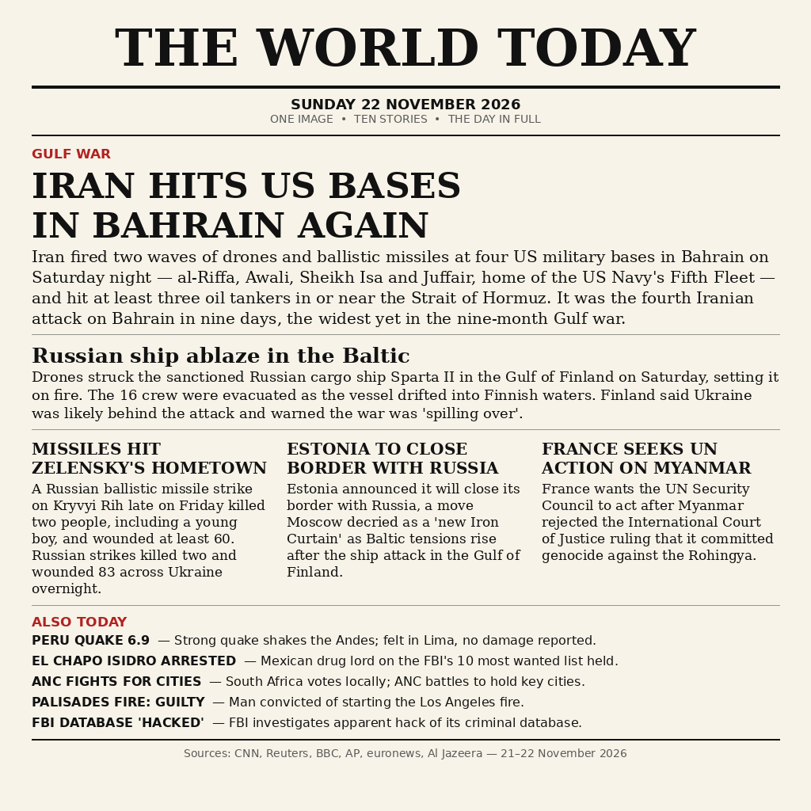

# The World Today — Sunday 22 November 2026

One image that sums up Sunday 22 November 2026's world news, drawn as a
newspaper front page: masthead, lead story, sub-head, three mid stories and a
five-item strip — ten verified stories in total.

## The ten stories

1. **Iran hits US bases in Bahrain again** — two waves of drones and
   ballistic missiles hit four US military bases in Bahrain on Saturday
   night (al-Riffa, Awali, Sheikh Isa and Juffair, home of the US Navy's
   Fifth Fleet); at least three oil tankers were hit in or near the Strait
   of Hormuz. The fourth Iranian attack on Bahrain in nine days.
2. **Russian ship ablaze in the Baltic** — drones struck the sanctioned
   Russian cargo ship Sparta II in the Gulf of Finland on Saturday; the 16
   crew were evacuated as the vessel drifted into Finnish waters. Finland
   said Ukraine was likely behind the attack.
3. **Missiles hit Zelensky's hometown** — a Russian ballistic missile strike
   on Kryvyi Rih late on Friday killed two people, including a young boy,
   and wounded at least 60.
4. **Estonia to close border with Russia** — Moscow decried the move as a
   "new Iron Curtain" as Baltic tensions rise.
5. **France seeks UN action on Myanmar** — France wants the UN Security
   Council to act after Myanmar rejected the ICJ ruling that it committed
   genocide against the Rohingya.
6. **Peru quake 6.9** — a magnitude 6.9 earthquake shook the Andes in
   central Peru, felt in Lima; no damage or casualties immediately reported.
7. **El Chapo Isidro arrested** — the Mexican drug lord on the FBI's 10 most
   wanted list was arrested in a shoot-out.
8. **ANC fights for cities** — South Africa voted in local elections; the
   ANC battles to keep control of key cities.
9. **Palisades fire: guilty** — a man was convicted of starting the
   Palisades fire in Los Angeles.
10. **FBI database "hacked"** — the FBI is investigating an apparent hack of
    its criminal database.

Sources: CNN, Reuters, BBC, AP, euronews, Al Jazeera — 21–22 November 2026.
See `dev/research-20261122.md` in the build workspace for the full source list.

## How it works

`main.ts` (Node 22, standard library only) validates the front-page PNG
shipped in this repository (`entry.png`, 1024×1024) and writes exactly one
image to `/output/entry.png`. It makes no network requests and is fully
deterministic: two runs produce byte-identical output.
